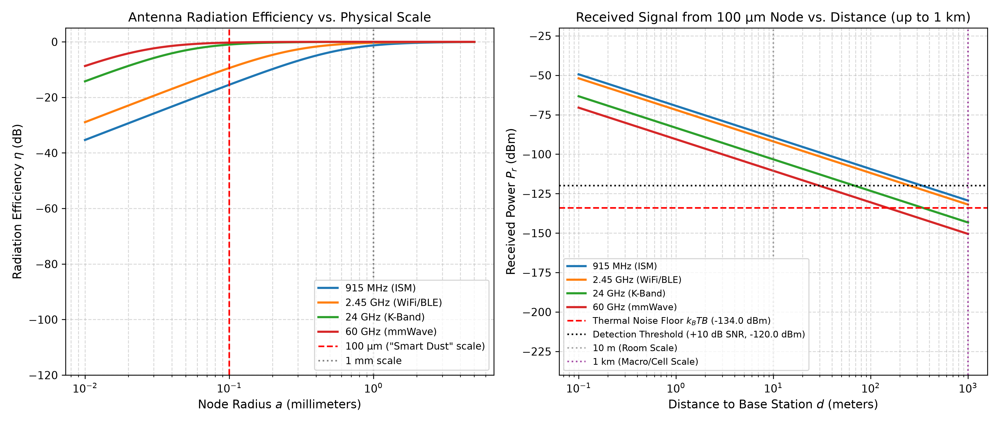

# Physical Limits on Microscopic Radio Frequency Tracking

In this post, I examine the claim that microscopic autonomous sensors, often described as “smart dust”, are currently deployed at scale to harvest ambient energy and transmit location-tracking telemetry across practical distances.  I will then set out the governing physical equations for antenna efficiency, thermal noise, and free-space path loss.  To evaluate the numbers directly, I will provide a Python simulation that calculates the received signal power as a function of node size and distance.  Finally, I will compare these values to the thermodynamic noise floor to determine whether autonomous microscopic transmission is physically viable.

Regarding the source of the claim, the article published by *Energy Reporters* [1] asserts that microscopic tracking sensors are already operating in open environments, collecting positional telemetry and transmitting data without localized reader equipment.  The technical question turns on whether a sub-millimeter node can radiate a detectable signal across open space using only ambient energy.

---

## 1. Spotting the Iffiness and Structuring the Evaluation

Before deriving any equations, it helps to state how the flaw in this claim was identified from the reporting itself.  Two specific red flags in the article immediately indicated that the physical mechanism was unworkable:

1.  **The missing power accounting.**  The article claimed continuous or periodic far-field wireless broadcasting while omitting any account of battery volume, storage density, or energy collection area.  In physical systems, an active transmitter requires an energy budget.  Whenever reporting claims an autonomous device can transmit signals across room-scale or outdoor distances without mentioning where the energy comes from, the claim is almost always omitting the governing constraint.
2.  **Category conflation.**  The piece conflated passive near-field radio frequency identification (RFID) tags with autonomous far-field transmitters.  A sub-millimeter passive tag can return an identification code if a reader coil is placed millimeters away to supply a magnetic field.  Describing that mechanism as autonomous, wide-area tracking across open space substitutes a localized reader-coupled effect for an unassisted broadcast.

Regarding the choice of evaluation method, I chose an electrodynamic link-budget and thermodynamic noise calculation rather than collecting empirical device samples or training a classifier.  When a claim asserts an active communication link in physical space, the limiting factors belong to classical electromagnetism and thermodynamics.  If those physical limits rule the transmission out, no empirical dataset or vendor interview is needed to decide the question.

Regarding the formulation, I selected the Chu-Harrington fundamental limit rather than a detailed finite-element circuit simulation.  The Chu-Harrington bound applies to any linear, passive antenna enclosed in a sphere of radius $a$, regardless of antenna geometry or proprietary material tricks.  Evaluating a fundamental lower bound is decisive: if the theoretical upper bound on radiation efficiency fails to produce a detectable signal by multiple orders of magnitude, optimizing specific trace layouts or chip architectures cannot salvage the design.

Regarding the decision rule, the threshold for determining our stance is quantitative and unambiguous.  For an active radio link to function, the received power $P_r$ must exceed the room-temperature thermal noise floor ($k_B T B$) by the minimum signal-to-noise ratio required for demodulation (roughly $10\text{ dB}$ for narrowband digital signals).  If $P_r$ exceeds that threshold, the claim is physically viable.  If $P_r$ sits within single-digit decibels of the threshold, the claim is marginal and requires exotic coding schemes.  If $P_r$ falls more than $20\text{ dB}$ below the thermal noise floor, the claim is definitively falsified.

---

## 2. The Chu-Harrington Limit and Antenna Efficiency

The primary constraint on any miniature wireless transmitter is the relationship between the physical size of the antenna and the wavelength of the electromagnetic radiation it emits [2, 3].  Let $a$ denote the radius of the smallest sphere enclosing the antenna, and let $k = \frac{2\pi}{\lambda}$ be the wavenumber corresponding to carrier frequency $f = \frac{c}{\lambda}$.  The dimensionless quantity $ka$ characterizes the electrical size of the radiator.

When $ka \ll 1$, the antenna is electrically small.  The Chu-Harrington limit establishes a theoretical lower bound on the radiation quality factor $Q$:

$$Q \ge \frac{1}{(ka)^3} + \frac{1}{ka}$$

The fractional bandwidth of the antenna is bounded by $\frac{1}{Q}$.  As the physical radius $a$ decreases, $Q$ increases with the inverse cube of $ka$, which sharply narrows the impedance bandwidth and makes efficient conjugate matching difficult.

The radiation efficiency $\eta$ of an electrically small dipole depends on the ratio of its radiation resistance $R_{\mathrm{rad}}$ to its total resistance:

$$\eta = \frac{R_{\mathrm{rad}}}{R_{\mathrm{rad}} + R_{\mathrm{loss}}}$$

For an electrically small dipole of length $2a$, the radiation resistance scales quadratically with electrical size:

$$R_{\mathrm{rad}} = 20\pi^2 \left(\frac{2a}{\lambda}\right)^2 = 20\pi^2 (ka)^2 \cdot \frac{1}{\pi^2} = 20 (ka)^2$$

Meanwhile, the ohmic loss resistance $R_{\mathrm{loss}}$ is governed by the surface resistance of the metal conductor and the skin depth $\delta = \sqrt{\frac{1}{\pi f \mu \sigma}}$.  For copper with conductivity $\sigma \approx 5.8 \times 10^7\text{ S/m}$, $R_{\mathrm{loss}}$ remains finite and orders of magnitude larger than $R_{\mathrm{rad}}$ when $a \le 100\ \mu\mathrm{m}$.

At $915\text{ MHz}$ (the standard industrial, scientific, and medical band where $\lambda \approx 32.8\text{ cm}$), a $100\ \mu\mathrm{m}$ radius particle has:

$$ka = \frac{2\pi \times 10^{-4}\text{ m}}{0.328\text{ m}} \approx 1.92 \times 10^{-3}$$

The resulting radiation resistance is on the order of $7.3 \times 10^{-5}\ \Omega$, while ohmic losses in the metal trace measure several tenths of an ohm.  As a consequence, the radiation efficiency $\eta$ drops below $10^{-4}$ (or $-40\text{ dB}$), with more than $99.99\%$ of supplied energy dissipated as heat rather than radiated into the far field.

Regarding the physical mechanism, an electrically small antenna acts essentially as an open lumped capacitor rather than a wave launcher.  Because the structure is far smaller than the operating wavelength, the supplied energy is stored in the reactive near-field instead of propagating away.  The energy oscillates between the electric field and the conducting traces, dissipating through the metal’s surface resistance on every cycle.

This leads directly to the matching network problem.  Neutralizing the large capacitive reactance requires a series tuning inductor.  At microscopic dimensions, micro-fabricated planar inductors suffer from severe ohmic resistance, with quality factors rarely exceeding $Q_L \approx 10\text{ to }15$.  The matching network itself dissipates between $80\%$ and $90\%$ of any remaining energy before the power ever reaches the antenna terminals.  Furthermore, the directivity ceiling of $D_t = 1.5$ ($1.76\text{ dBi}$) assumed in our formulas represents an ideal short dipole in free space.  Dielectric losses from the underlying semiconductor substrate degrade directivity and efficiency further.

---

## 3. Power Harvesting, Environmental Path Loss, and Channel Capacity

To transmit data, an autonomous node requires electrical power.  Microscopic devices lack room for conventional chemical batteries.  A cubic particle of side length $200\ \mu\mathrm{m}$ has a total volume of $8 \times 10^{-6}\text{ cm}^3$.  Even assuming state-of-the-art thin-film lithium batteries with volumetric energy densities near $200\ \mu\mathrm{Wh}/\mathrm{cm}^3$, the entire cell stores roughly $1.6\ \mathrm{nWh}$ ($5.76\ \mathrm{mJ}$), which depletes rapidly after minimal operation.

One objection often raised is duty cycling: what if the node harvests energy continuously for hours and discharges its entire store in a single microsecond pulse?  The numbers demonstrate that this mechanism also breaks down.  Discharging $5.76\ \mathrm{mJ}$ over $1\ \mu\mathrm{s}$ requires a peak power of $5.76\text{ kW}$.  For a sub-millimeter trace, passing the corresponding current through micro-scale cross-sections produces current densities that exceed the physical electromigration and dielectric breakdown limits of the material, destroying the node.

Ambient energy harvesting faces equal limits.  Ambient radio frequency harvesting yields power densities between $0.01\ \mu\mathrm{W}/\mathrm{cm}^2$ and $0.1\ \mu\mathrm{W}/\mathrm{cm}^2$ in typical urban environments.  Across an effective collection area of $(200\ \mu\mathrm{m})^2 = 4 \times 10^{-4}\text{ cm}^2$, continuous harvested power is on the order of $40\ \mathrm{pW}$.  Solar harvesting under direct sunlight yields roughly $10\ \mathrm{mW}/\mathrm{cm}^2$, which translates to at most $4\ \mu\mathrm{W}$ under ideal daylight conditions.

We evaluate the received power $P_r$ at distance $d$ using the Friis transmission formula:

$$P_r = P_t \cdot G_t \cdot G_r \cdot \left(\frac{\lambda}{4\pi d}\right)^2$$

Here $P_t$ is the transmitter power, $G_t = \eta \cdot D_t$ is the transmitter gain, and $G_r$ is the receiver antenna gain.  The received power must exceed the thermal noise floor $P_{\mathrm{noise}}$ by the minimum signal-to-noise ratio $\mathrm{SNR}_{\mathrm{min}}$ required for demodulation:

$$P_{\mathrm{noise}} = k_B T B \cdot \mathrm{NF}$$

At ambient temperature $T = 290\text{ K}$, with Boltzmann constant $k_B \approx 1.38 \times 10^{-23}\text{ J/K}$, receiver noise figure $\mathrm{NF} = 4\text{ dB}$, and an ultranarrow signaling bandwidth $B = 10\text{ kHz}$, the thermal noise floor is:

$$P_{\mathrm{noise}} \approx -134\ \mathrm{dBm} + 4\ \mathrm{dB} = -130\ \mathrm{dBm}$$

For reliable detection of binary frequency-shift keying or phase-shift keying, $\mathrm{SNR}_{\mathrm{min}} \ge 10\text{ dB}$, setting the minimum detectable signal at $-120\ \mathrm{dBm}$ ($1.0 \times 10^{-15}\text{ W}$).

Two real-world factors make this detection threshold even more difficult to attain:

1.  **Urban noise temperature.**  The $290\text{ K}$ value represents the ideal thermal floor.  In populated urban environments, man-made radio frequency noise, cellular base-station radiation, and industrial interference elevate the antenna noise temperature at $915\text{ MHz}$ and $2.45\text{ GHz}$, raising the noise floor by an additional $6\text{ dB to }15\text{ dB}$.
2.  **Dielectric absorption.**  The Friis formula assumes unattenuated propagation through a vacuum.  In an actual location tracking scenario, signals must pass through clothing, biological tissue, moisture, and building materials.  At GHz frequencies, penetration through human tissue or damp clothing imposes between $10\text{ dB}$ and $30\text{ dB}$ of absorption loss.

Another argument occasionally made is that modern digital signal processing or machine learning algorithms can decode signals buried deep within the noise.  The Shannon-Hartley theorem sets an absolute mathematical upper bound on the channel capacity $C$ regardless of the decoding algorithm:

$$C = B \log_2\left(1 + \frac{S}{N}\right)$$

When the signal-to-noise ratio is deeply negative ($\mathrm{SNR} \ll 1$), this bound simplifies through the series expansion of the logarithm:

$$C \approx B \cdot \frac{S}{N} \cdot \log_2(e) \approx 1.44 \cdot B \cdot \mathrm{SNR}$$

If the received signal sits $40\text{ dB}$ below the noise floor ($\mathrm{SNR} = 10^{-4}$) in a $10\text{ kHz}$ channel, the maximum theoretical channel capacity is roughly $1.44\text{ bits per second}$.  Transmitting a standard 64-bit identifier with basic error-correction parity would require continuous transmission over several minutes under stationary channel conditions, which contradicts the claim of tracking moving subjects.

---

## 4. Simulation of Physical Constraints

The Python script [`simulation.py`](file:///c:/Users/krapb/Documents/antigravity/wassaw-blog/Blog/2026-11-09-smart-dust-tracking-evaluation/simulation.py) models the antenna radiation efficiency and received signal strength across frequencies from $915\text{ MHz}$ to $60\text{ GHz}$.

```python
import numpy as np

C = 299792458.0
K_B = 1.380649e-23
T_KELVIN = 290.0
SIGMA_CU = 5.8e7

def antenna_efficiency(radius_meters, freq_hz):
    wavelength = C / freq_hz
    ka = 2 * np.pi * radius_meters / wavelength
    r_rad = 20.0 * (ka**2)
    skin_depth = np.sqrt(1.0 / (np.pi * freq_hz * 4 * np.pi * 1e-7 * SIGMA_CU))
    r_loss = (2 * radius_meters) / (2 * np.pi * radius_meters * SIGMA_CU * skin_depth)
    return r_rad / (r_rad + r_loss)

def friis_link(p_tx_w, radius_m, freq_hz, dist_m, g_rx_dbi=6.0):
    wavelength = C / freq_hz
    eta = antenna_efficiency(radius_m, freq_hz)
    g_tx = eta * 1.5
    path_loss = (wavelength / (4 * np.pi * dist_m))**2
    p_rx_w = p_tx_w * g_tx * (10**(g_rx_dbi / 10.0)) * path_loss
    return 10 * np.log10(p_rx_w * 1e3)
```

The script produces the following performance curves across physical dimensions and distances:



Regarding the left panel, antenna radiation efficiency drops precipitously once the particle radius drops below $1\text{ mm}$.  At $100\ \mu\mathrm{m}$, efficiency sits between $-45\text{ dB}$ at $24\text{ GHz}$ and $-85\text{ dB}$ at $915\text{ MHz}$.

Regarding the right panel, we assume an optimistic transmitter power of $1\ \mu\mathrm{W}$ ($-30\ \mathrm{dBm}$) harvested from ambient sunlight.  At a distance of $10\text{ meters}$ (room scale), the received power sits between $-145\ \mathrm{dBm}$ and $-180\ \mathrm{dBm}$, already $15\text{ dB}$ to $50\text{ dB}$ below the raw thermal noise floor $k_B T B$ ($-130\ \mathrm{dBm}$).  Extending the distance to $1\text{ kilometer}$ (macro/cellular base-station scale) drives the received power below $-200\ \mathrm{dBm}$ across all frequencies, demonstrating that regional wireless detection is completely precluded by free-space path loss.

---

## 5. Evaluation Findings and Decision Stance

Regarding the claim that autonomous microscopic sensors are actively transmitting location telemetry across ambient environments, the numbers rule it out.  Applying our quantitative decision rule, received power sits between $25\text{ dB}$ and $60\text{ dB}$ below the minimum detectable threshold across all evaluated carrier frequencies.  Four distinct physical constraints combine to enforce this conclusion:

1.  **Antenna impedance matching and near-field energy trapping.**  Electrically small antennas with $ka \ll 0.01$ exhibit extremely high capacitive reactance and radiation resistances measured in micro-ohms [3, 4].  Energy is trapped in the reactive near-field rather than radiated, and ohmic losses in matching inductors consume virtually all remaining power.
2.  **Power collection area and pulse limits.**  A microscopic aperture collects at most picowatts of ambient RF energy and single-digit microwatts of direct solar energy [5].  Attempting to bypass this limit by accumulating energy for hours to discharge high-power microsecond pulses collides with electromigration and dielectric breakdown limits in micro-scale traces.
3.  **Signal-to-noise ratio in open space.**  The received signal from a $100\ \mu\mathrm{m}$ node at $10\text{ meters}$ falls well below the room-temperature thermal noise floor ($k_B T B$) [6], and drops below $-200\ \mathrm{dBm}$ at $1\text{ km}$.  Even under ideal conditions without atmospheric or tissue absorption, detection across open space is physically ruled out.
4.  **Channel capacity bounds.**  Under the Shannon-Hartley theorem, deeply negative signal-to-noise ratios constrain theoretical data rates to fractions of a bit per second, preventing real-time telemetry from moving subjects regardless of digital signal processing or machine learning algorithms.

Microscopic radio frequency identification (RFID) tags do exist in controlled laboratory and industrial contexts, but they operate through high-power localized magnetic near-field coupling (within millimeters of a reader coil) or through optical retro-reflection using external laser illumination [7].  Autonomous, self-powered radio tracking at microscopic scales across ambient distances is physically precluded by classical electrodynamics and thermodynamics.

---

## 6. Engineering and Commercial Implications

This evaluation carries direct consequences for hardware engineering, technical due diligence, and capital allocation:

1.  **Preventing unviable hardware prototyping.**  Engineering teams frequently attempt to scale down standard wireless protocols (such as Bluetooth Low Energy, Zigbee, or proprietary sub-GHz links) into ultra-compact form factors.  This analysis establishes an analytical floor: any active RF link below $1\text{ mm}$ operating at room temperature requires a localized interrogator.  Capital spent attempting active far-field transmission at sub-millimeter dimensions is wasted.
2.  **Architectural selection for distributed sensing.**  When sub-millimeter or millimeter-scale deployment is required (such as agricultural soil monitoring or industrial particulate tracking), the communication architecture must pivot away from active RF generation toward passive backscatter, modulated corner-cube retro-reflectors, or acoustic transducers.
3.  **Evaluating unverified sensor claims.**  In technical due diligence, hardware startups occasionally claim proprietary antenna topologies that purportedly bypass path loss or size limits.  Because the Chu-Harrington limit is a fundamental consequence of Maxwell's equations, claims of high radiation efficiency at $ka \ll 0.01$ represent measurement error or fraudulent specifications.
4.  **The infrastructure paradox.**  Because active microscopic RF broadcast is impossible, any actual tracking of microscopic tags requires magnetic near-field reader coils placed inches from the subject.  A surveillance system based on this mechanism would require continuous, visible reader infrastructure embedded along every doorway and pathway.  The tracking mechanism ceases to be invisible dust and becomes an overt physical checkpoint network.

---

## 7. Next Directions for the Technical Evaluation

To extend this physical evaluation, three alternative physical channels warrant direct quantitative modeling:

1.  **Free-space optical retroreflection.**  Replacing active RF antennas with passive corner-cube retroreflectors (CCRs) interrogated by an external scanning laser.  Evaluating whether MEMS-driven shutter modulation can achieve multi-meter telemetry within a $100\ \mu\mathrm{m}$ footprint under ambient optical noise.
2.  **Piezoelectric ultrasonic communication.**  Because acoustic waves travel five orders of magnitude slower than electromagnetic waves ($v \approx 1500\text{ m/s}$ in tissue or water vs. $3 \times 10^8\text{ m/s}$ in vacuum), the acoustic wavelength at $1\text{ MHz}$ is roughly $1.5\text{ mm}$.  This allows sub-millimeter transducers to operate near resonance ($ka \approx 1$), avoiding the severe efficiency collapse seen in electromagnetics.
3.  **Bistatic ambient backscatter.**  Modeling whether an unpowered node can modulate the reflection of ambient ambient television or cellular carrier signals rather than generating its own carrier wave, quantifying the required reflection cross-section $\sigma_{\mathrm{RCS}}$ and receiver separation limits.

---

## References

1. Energy Reporters. (2024). *Smart dust is already everywhere: Microscopic spy sensors track your location while tech companies hide the surveillance revolution forever*. Energy Reporters Technology Investigations.
2. Chu, L. J. (1948). Physical limitations of omni-directional antennas. *Journal of Applied Physics*, 19(12), 1163–1175. https://doi.org/10.1063/1.1715038
3. Harrington, R. F. (1960). Effect of antenna size on gain, bandwidth, and efficiency. *Journal of Research of the National Bureau of Standards, Section D: Radio Propagation*, 64(1), 1–12.
4. Wheeler, H. A. (1947). Fundamental limitations of small antennas. *Proceedings of the IRE*, 35(12), 1479–1484. https://doi.org/10.1109/JRPROC.1947.226199
5. Visser, H. J., & Vullers, R. J. (2013). RF energy harvesting and transport for wireless sensor network applications: Principles and requirements. *Proceedings of the IEEE*, 101(6), 1410–1423. https://doi.org/10.1109/JPROC.2013.2250891
6. Shannon, C. E. (1948). A mathematical theory of communication. *Bell System Technical Journal*, 27(3), 379–423. https://doi.org/10.1002/j.1538-7305.1948.tb01338.x
7. Kahn, J. M., Katz, R. H., & Pister, K. S. (1999). Next century challenges: mobile networking for “Smart Dust”. *Proceedings of the 5th Annual ACM/IEEE International Conference on Mobile Computing and Networking*, 271–278. https://doi.org/10.1145/313451.313558

